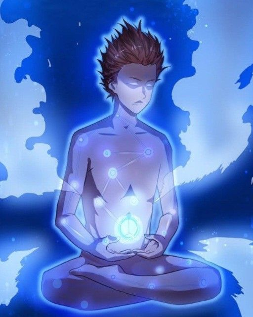
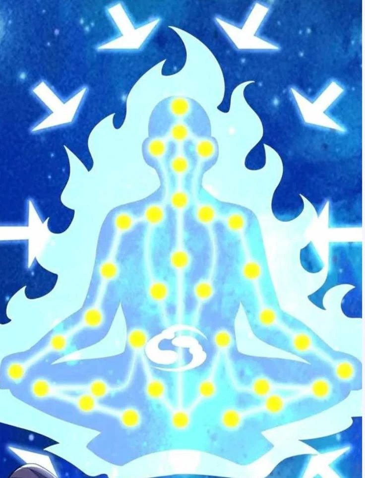
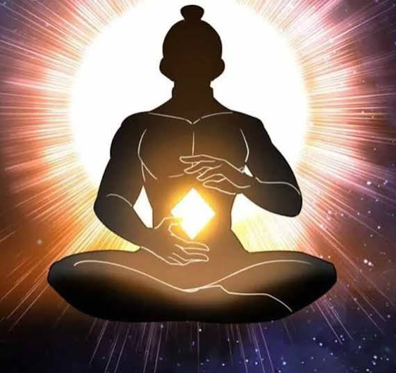
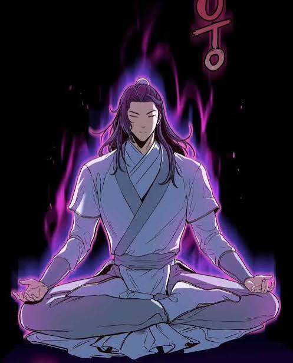
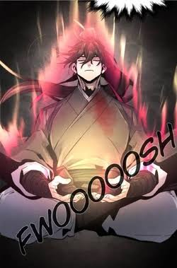
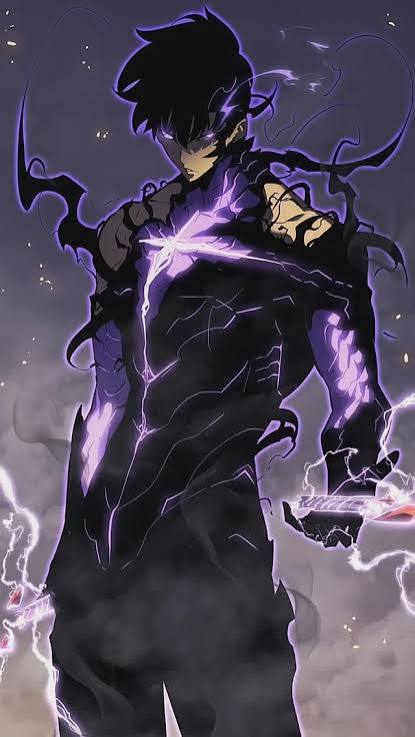
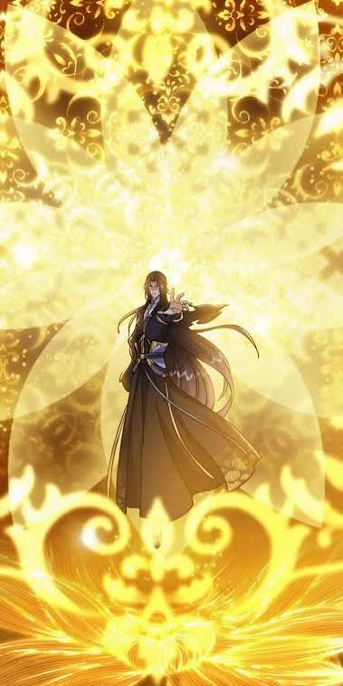
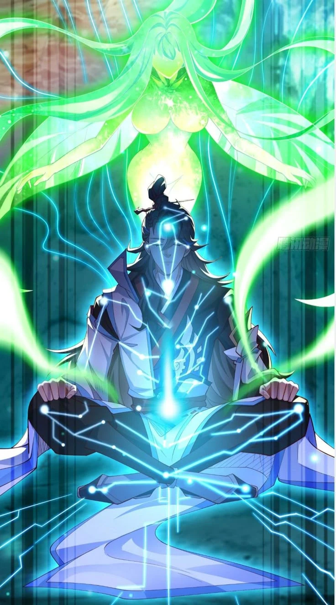
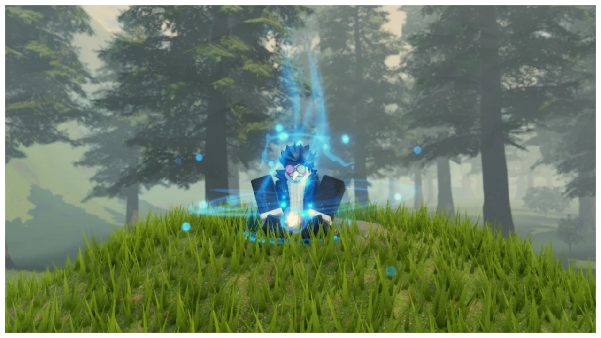
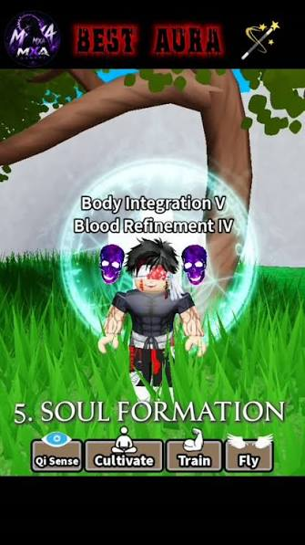

# Method auras

The visual a cultivation method gives you while you sit (meditating or
circulating), seen by everyone. It is how other players tell what you
cultivate and how good it is, so it should be the most covetable thing about
a method. Mechanics, data and the method list live in
[character.md](character.md); this doc is the art brief.

**Status:** Mortal auras built 2026-10-21 (vfx agent): every method has its
own aura, following this doc. Runtime `src/client/MethodAura.luau`, templates
`ReplicatedStorage.Effects.MethodAura.<MethodId>` (one Model per method),
builder `tools/vfx_specs/MethodAura.luau` (its header is the attribute
contract), Edit-mode preview `tools/aura_preview.luau`. Spirit, Earth and
Heaven looks are not built (no method uses those grades yet).

## What's built (Mortal)

| Method | On the body | Ground / around | Breath beat | Ignition |
|---|---|---|---|---|
| Sect Breathing | — | — | two faint motes rise from the belly | — |
| Blazing Heart | orange chest core that swells and flares on the breath (one PointLight); flame tongues off the arms and torso surface; embers; orange ForceField rim | thin fire ring | heartbeat flare at the chest, a warm ring breathes out | flames roar up off the seat, a fire ring climbs past the head, a flare ring rolls out; limb flames surge |
| Flowing Spring | blue tint over the body; blue belly core (light); droplets streaming in from a 7-stud shell to the core, faster on the inhale | still Neon pool disc with a pale rim | two ripples cross the pool | a wave rolls out, a ring springs up, droplets fall back |
| Evergreen Root | green meridian beams with glowing joint dots, lighting trunk-first (belly, chest, then shoulders and hips, then elbows and knees, then hands) over ~2 breaths; green seed at the belly; faint green tint | six crooked roots creeping out, slow falling leaves | sap motes, a green ring breathes out | a green ring bursts out, a wind-swirl ring rises, leaves whirl up |
| Iron Marrow | spinning gold gem between the hands (light); gold bone lines along the arms and spine; gold ForceField rim | thin gold ring | the clang: a thin ring snaps out level and one upright, sparks, a star; bone lines, rim and ring glint | a great clang ring, a sunburst flash, sparks, a steel ring across the ground |
| Mountain Breath | amber low-belly core (light); faint amber tint | heavy carved stone ring with a turning glowing rune circle that settles on each breath; five pebbles lifting on the inhale; dust | a slow amber ring out of the stone, a little dust | the ground thumps: ring, dust spray, grit jumps |
| Thunder Pulse | body darkened; violet-white jagged cracks across chest, belly and arms (re-jagged each burst); violet rim | flickering violet ring; on a burst jagged arcs from both hands to the ground | irregular bursts (0.5 to 2.6 s apart): chest flash, ground snap ring, sparks where the arcs land | a strike ring, arcs crackling round the body, a flash at the crown |
| Drifting Cloud | wisps lifting off the arms and torso; mint ForceField rim | a soft white cloud of puffs you sit on, a mint glow under it, two counter-turning wind rings that tighten on the inhale, streaks drawn inward | at the start of each inhale a wide wind ring sweeps in to the body | a gust ring bursts out, cloud puffs spray |
| Frost Lotus | pale rime ForceField rim | a glass lotus of three petal rings (inner, then one more each breath), flakes and crystals drifting down | breath mist from the mouth, a frost ring creeps out | a frost ring, shards thrown up, a cold flash at the chest |

How it is put together (details in the builder header):
- **Body first.** `Body` parts follow named body points (`Chest`, `Belly`,
  `Lap` between the hands...), `Limbs` emitters are cloned onto the body parts
  themselves (they emit off the limb's surface), `Lines` are Beams between
  attachments made on the body parts (ZOffset keeps them in front of the
  limb), and `Shell` parts are copied round every body part as a glowing skin.
  R6 and R15 map through `POINTS` / `LIMBS` in MethodAura.
- **Outline glow is a Shell, not a Highlight.** The map already holds ~480
  Highlights (fern and ground-cover outlines) and Roblox draws only 31, so an
  aura Highlight would rarely show. ForceField shells read as a rim; Neon
  shells at ~0.85 transparency read as a tint.
- **Breath:** one 5 s period for every aura (`Breath` on the root), energy 0 at
  rest to 1 mid-breath; `Breath` models fire on the beat (`BreathAt`, default
  the exhale). Thunder Pulse sets `Rhythm = "burst"`.
- **Ignition:** an aura that starts within 2 s of `Meditating` or `Method`
  changing plays its `Ignite` model and a 1.8 s surge (pieces brighter and
  bigger, limb emitters `Surge`); the `Breakthrough` remote replays it.
  Walking up to someone already seated doesn't ignite.
- **Grade hook:** `GRADES` in MethodAura scales the `Ground` model (reach),
  `Scaled` emitter rates and brightness. Mortal = 1.
- **Budget per aura:** one PointLight (none for Wind, Ice, Thunder, Sect),
  6 shell parts (R6), up to ~30 beams (Thunder's jagged cracks), a handful of
  emitters at 1 to 13 /s per limb. Sect Breathing auras rank after named
  methods for the 8 slots.
- **Palette for Neon:** bright pastels go white in Neon; ring and wave colours
  use the deeper shade of the element (violet, deep ice blue, burnt amber).

## Rules every aura follows

- **One method, one idea.** Each aura is built from the method's own idea (its
  name and blurb), not an element tint over a shared base. Two methods of the
  same element should still look nothing alike.
- **Grade sets the size, not the look.** The method decides what the aura is;
  its grade decides how far it reaches (table below). A Mortal aura stays on
  and close to the body; a Heaven one owns the screen.
- **It lives on the body first.** The references glow from inside the figure:
  a core, lines, an outline, flame hugging the silhouette. Ground rings and
  floating props are support, not the main event.
- **It breathes.** Every aura follows the shared breath (inhale gathers,
  exhale releases), so a seated crowd feels calm, not noisy. Thunder Pulse is
  the one deliberate exception (sudden bursts).
- **It reads in daylight.** The references sit on dark backgrounds; ours sit on
  green grass at noon. Use Neon, `LightInfluence = 0`, strong brightness and
  dark-edged shapes so it doesn't wash out.
- **Ignition.** Sitting down, switching method and breaking through play a
  one-shot surge of the aura (ref: red flame surge, hair and robes lifting)
  before it settles into its loop. This is what makes switching feel like an
  event.
- **Budget.** Up to 8 auras draw at once (`MAX_AURAS`), on phones too. Prefer a
  few strong pieces (a Highlight outline, beams, one core, one emitter per
  limb) over many particles. Works on R15 and R6 (beams and emitters hang off
  attachments that exist on both, or fall back to the torso).

Roblox pieces that match the reference looks:

| Look | Build it with |
|---|---|
| Outline glow | `Highlight` (outline only, or a faint fill); ≤31 on screen, so fine at 8 |
| Lit core (dantian, chest, between hands) | small Neon sphere or flipbook billboard + `PointLight` at the torso |
| Meridians, constellations, cracks | `Beam`s between attachments on body parts, with dots at the joints |
| Flame or frost hugging the body | short `ParticleEmitter`s on each limb, emitting along the surface |
| Qi streaming inward | particles spawned on a shell that travel to the core (negative speed or attractor) |
| Backdrop (mandala, sunburst, spirit) | a large camera-facing billboard or decal behind the player, Spirit grade and up |

## Grade scale

| Grade | Reach | Adds |
|---|---|---|
| Mortal | on the body, ~1 body-width around | core, outline, the method's signature on the body, a small ground touch |
| Spirit | ~2× radius, rises to above the head | the signature spreads into the space round you (a full ground figure, things orbiting) |
| Earth | fills a ~15-stud circle, visible across a plaza | a backdrop: mandala, sunburst or sigil behind the player |
| Heaven | the screen; a column or sky effect seen from far away | a manifestation: the method's spirit or beast rising behind, a light pillar |

All current methods are Mortal (Sect Breathing aside). Their "higher grade"
lines below say where the method's family goes when a stronger version exists.

## The current methods

| Method | Idea | Mortal aura (build now) | Higher grades | Refs |
|---|---|---|---|---|
| Sect Breathing | the basics | none; a faint mote or two on the breath at most | — | — |
| Blazing Heart Sutra (Fire) | a heart that burns | an orange core in the chest that beats on the breath; short flame tongues licking up from shoulders and arms; embers rising; warm outline | flames climb into a crown of fire above the head, then a burning lotus behind; Heaven: a phoenix silhouette | red_flame_surge, purple_flame_outline |
| Flowing Spring Scripture (Water) | water gathering into a still pool | a mirror-still pool disc under you, one ripple per breath; droplet streams drawn inward to a soft blue core in the belly; cool blue body glow | the pool widens with lotus pads and the streams come from farther away; Heaven: a waterfall of qi pouring into you from above | meridians_qi_inflow, constellation_dantian_core |
| Evergreen Root Canon (Wood) | an old tree, patient growth | green meridian lines that grow like branches from the belly out along the arms, lighting slowly over a few breaths; thin roots spreading on the ground; a few slow leaves | the branches leave the body and form a tree canopy over you; Heaven: a dryad spirit rising behind | spirit_manifest_green |
| Iron Marrow Art (Metal) | qi hammered into the bones | a hard white-gold diamond core between the hands; on each exhale a clang: a thin metal ring snaps outward with sparks; a cold steel glint sweeps the outline | the clang becomes a sunburst of blades behind you; Heaven: a radiant halo of swords | sunburst_diamond_core |
| Mountain Breath Method (Earth) | deep, steady as stone | an amber core low in the belly; a carved stone rune ring under you that settles a little with each breath; a few pebbles lifting very slowly; dust | stones orbit in a heavy ring; Heaven: a mountain silhouette behind | (none yet) |
| Thunder Pulse Manual (Lightning, rare) | sudden bursts | dark idle with glowing purple-white cracks across the torso and arms that flare irregularly; arcs jump from hands to the ground on a burst; ozone sparks | arcs fill the space and strike the ground around you; Heaven: a thunder dragon coiled behind | dark_lightning_cracks |
| Drifting Cloud Scripture (Wind, rare) | qi drifting in on the wind | a soft cloud you sit on; pale wind streaks spiral in toward you on each inhale and loosen on the exhale; robes and hair lift faintly | a slow vortex column around you; Heaven: a sea of clouds spreading out from your seat | (none yet) |
| Frost Lotus Sutra (Ice, rare) | blooming cold and clear | frost spreading on the ground in a lotus shape that opens a petal ring per breath; a rime outline; breath mist; a few flakes | a crystal lotus blooms around you; Heaven: a giant ice lotus behind, snow falling across the area | constellation_dantian_core (cold blue palette) |

## Reference images

From the user, in `docs/reference/auras/`. The names in the Refs column above
point here.

**On the body (Mortal and up)**

| | |
|---|---|
|  | **constellation_dantian_core**: glowing acupoints joined by thin lines, a sigil core in the belly, the body faintly see-through. |
|  | **meridians_qi_inflow**: the meridian map lit with points, qi arrows streaming in from all sides. |
|  | **sunburst_diamond_core**: a hard bright diamond between the hands, a dark silhouette, rays bursting behind. |
|  | **purple_flame_outline**: flame hugging the silhouette like an outline, rising off the shoulders. |
|  | **red_flame_surge**: an upward surge, hair and robes lifting; the ignition moment. |
|  | **dark_lightning_cracks**: glowing cracks across a dark body, arcs, smoke tendrils. |

**Backdrops and manifestations (Earth and Heaven)**

| | |
|---|---|
|  | **gold_mandala_backdrop**: a giant lotus mandala filling the space behind the figure. |
|  | **spirit_manifest_green**: meridian lines on the body plus a spirit rising behind. |

**Other Roblox games (the bar to clear, not the target)**

| | |
|---|---|
|  | **roblox_seated_blue_wisps**: a seated aura with wisps, motes and a ground ring. |
|  | **roblox_bubble_skulls**: a bubble shell with floating icons. |

## Inventing a new method and its aura

Use this to add methods (and their auras) that fit the world. Fill in the card,
then add the def to `src/shared/Methods.luau` and the aura to the table above.

1. **Start from a verb, not an element.** What does the method do to qi?
   Burns, gathers, grows, hammers, settles, bursts, drifts, blooms, devours,
   reflects, sings, seals. The verb gives the motion; the element only gives
   the palette.
2. **Name it like a scripture:** an image plus a text type ("Sutra",
   "Scripture", "Canon", "Art", "Manual", "Method", "Classic", "Record").
   Blurb: one line, "Qi ... like ...".
3. **Pick its home on the body:** heart, belly (dantian), hands, spine, eyes,
   skin, bones, the ground under you, the air around you. Methods in the same
   element should pick different homes.
4. **Pick its rhythm:** with the breath (most), a heartbeat, slow over many
   breaths, sudden bursts, constant flow.
5. **Pick one shape motif** that recurs from Mortal to Heaven: a lotus, a
   ring, cracks, branches, a diamond, blades, stones, clouds, a sigil, eyes.
6. **Write its grade ladder:** what the motif becomes at Spirit, Earth and
   Heaven (the backdrop and the manifestation).
7. **Check it against the others:** at a glance, from 30 studs, on grass at
   noon, could you tell it from every existing aura? If two share home,
   rhythm and motif, change one.

Card:

```
Name / element / grade:
Verb (what it does to qi):
Blurb:
Home on the body:
Rhythm:
Motif:
Mortal aura:
Spirit / Earth / Heaven:
Refs:
```

Seeds for later methods (not designed yet): a devouring method that drains
nearby qi motes into you (dark, inward vortex); a sword-heart method whose
qi forms floating blades; a mirror method with a reflective halo; a blood
method whose veins glow red; a starlight method with a constellation across
the body and a night-sky backdrop; a sound method with rings of visible
chant.

## Known gaps

- Only the Mortal column is built; the Spirit/Earth/Heaven looks (spreading
  figures, backdrops, manifestations) wait for methods of those grades.
- No refs yet for Mountain Breath or Drifting Cloud.
- Robes and hair can't lift (avatar clothing isn't ours to move); Drifting
  Cloud and the ignitions stand in with rising wisps and flames.
- Previewed in Edit mode on the R6 test rig only (grass at noon and night);
  R15 avatars and real accessories, phone performance with 8 auras, and the
  live sit / switch / breakthrough ignition are untested in play.
- The map's ~480 Highlights fill Roblox's 31-highlight budget, so other
  Highlight effects (the Iron Skin buff glow, the perfect-circulation rim,
  hit flashes in `CombatEffects`) may not render near the map either.
