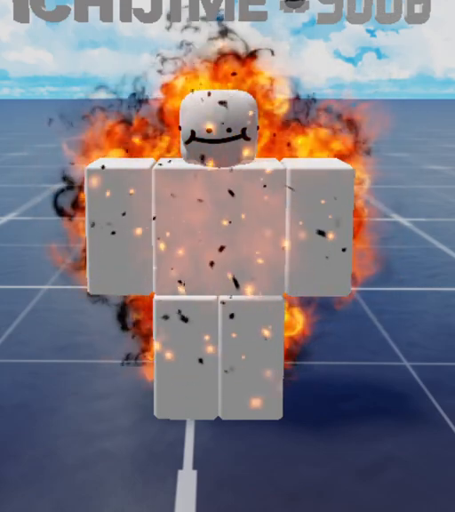
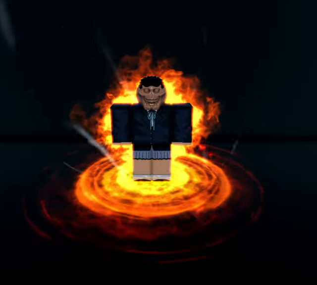

# Method auras

The visual a cultivation method gives you while you sit (meditating or
circulating), seen by everyone. It is how other players tell what you
cultivate and how good it is, so it should be the most covetable thing about
a method. Mechanics, data and the method list live in
[character.md](character.md); this doc is the art brief.

**Status:** Mortal auras built 2026-10-21 (vfx agent): every method has its
own aura, following this doc. Runtime `src/client/MethodAura.luau`, templates
`ReplicatedStorage.Effects.MethodAura.<MethodId>` (one Model per method),
builder `tools/vfx_specs/MethodAura.luau` (its header is the attribute
contract), Edit-mode preview `tools/aura_preview.luau`. Spirit, Earth and
Heaven looks are not built (no method uses those grades yet).

**Rework due (decided 2026-10-21, user):** the Mortal pass is mostly parts
(Neon and ForceField shells, discs and rings animated in code, ~20 textures,
about 1.5 loop emitters per aura) and reads thin. Auras are to be rebuilt as
layered emissions from the vfx library, modelled on Sol's RNG auras, with
parts only in support. The method is in [docs/vfx/style.md](../vfx/style.md)
("Auras"). **Blazing Heart is reworked** (2026-10-21, below); the other seven rows
still describe the first, part-heavy pass. Blazing Heart shows the bar for
size and quality, not a template: each method's rework starts from its own
idea and references, not from Blazing Heart's layers or textures.

Mortal means small and close but high in quality (user, 2026-10-21): within
about one body-width, a gentle loop, no screen dimming or towering shapes, and
an ignition that is a short, punchy flash and flare on and near the body.

The spirit root reveal (`src/client/RootFX.luau`, template
`Effects.RootPillar`) speaks the same language: each element's pillar carries
its methods' motifs (Fire's heart and flame crown, Water's pool and ripples,
Wood's roots and branches, Metal's gem and clang rings, Earth's rune stone
ring, Lightning's bolts, Wind's vortex, Ice's glass lotus); see
[character.md](character.md), "The reveal". A new element's reveal should
reuse its first method's motif.

## What's built (Mortal)

| Method | On the body | Ground / around | Breath beat | Ignition |
|---|---|---|---|---|
| Sect Breathing | — | — | two faint motes rise from the belly | — |
| Blazing Heart (reworked: 17 loop emitters, no shell) | white-hot heart core at the chest (glow that swells with the breath, a hard dot, a twinkling 4-point glint, the one PointLight); a flame mantle (library aura-flame flipbook) hugging the silhouette from behind on a darker soot copy of itself; realistic flipbook flames licking off the arms and torso; a small crown of licks off the head; black soot curling off the flame tips; embers and dark ash flecks. Flames, mantle and ground fire grow and shrink with the breath and drift slowly in size | dark scorch disc, warm heat pool, a turning fire swirl, small flames on the rim; four hui-wen sigils: one on the ground turning against the swirl, three raised round the chest (added by the user, centred and level on the body axis) each turning its own way and drifting up, fading and starting again; all breathe in size and flash on the heartbeat and pulses | a heartbeat: lub-dub glow at the chest with a glint and a spark puff, the mantle flares, a fire ring pulses out of the sigil. Every 1 or 2 breaths (about 5 or 10 s, a little late at random) the beat is a pulse instead: a lighter punch (flash and star at the heart, a starburst, embers, a few flame jets and flames, a ground ring, limb flames surging), the aura swelling into it | once fully seated: white flash and a chromatic star at the heart, a starburst flare, flame jets and flipbook flames roaring up round the body, a fire ring burning out over the ground, soot thrown low, an ember burst; limb flames surge |
| Flowing Spring | blue tint over the body; blue belly core (light); droplets streaming in from a 7-stud shell to the core, faster on the inhale | still Neon pool disc with a pale rim | two ripples cross the pool | a wave rolls out, a ring springs up, droplets fall back |
| Evergreen Root | green meridian beams with glowing joint dots, lighting trunk-first (belly, chest, then shoulders and hips, then elbows and knees, then hands) over ~2 breaths; green seed at the belly; faint green tint | six crooked roots creeping out, slow falling leaves | sap motes, a green ring breathes out | a green ring bursts out, a wind-swirl ring rises, leaves whirl up |
| Iron Marrow | spinning gold gem between the hands (light); gold bone lines along the arms and spine; gold ForceField rim | thin gold ring | the clang: a thin ring snaps out level and one upright, sparks, a star; bone lines, rim and ring glint | a great clang ring, a sunburst flash, sparks, a steel ring across the ground |
| Mountain Breath | amber low-belly core (light); faint amber tint | heavy carved stone ring with a turning glowing rune circle that settles on each breath; five pebbles lifting on the inhale; dust | a slow amber ring out of the stone, a little dust | the ground thumps: ring, dust spray, grit jumps |
| Thunder Pulse | body darkened; violet-white jagged cracks across chest, belly and arms (re-jagged each burst); violet rim | flickering violet ring; on a burst jagged arcs from both hands to the ground | irregular bursts (0.5 to 2.6 s apart): chest flash, ground snap ring, sparks where the arcs land | a strike ring, arcs crackling round the body, a flash at the crown |
| Drifting Cloud | wisps lifting off the arms and torso; mint ForceField rim | a soft white cloud of puffs you sit on, a mint glow under it, two counter-turning wind rings that tighten on the inhale, streaks drawn inward | at the start of each inhale a wide wind ring sweeps in to the body | a gust ring bursts out, cloud puffs spray |
| Frost Lotus | pale rime ForceField rim | a glass lotus of three petal rings (inner, then one more each breath), flakes and crystals drifting down | breath mist from the mouth, a frost ring creeps out | a frost ring, shards thrown up, a cold flash at the chest |

How it is put together (details in the builder header):
- **Body first.** `Body` parts follow named body points (`Chest`, `Belly`,
  `Lap` between the hands...), `Limbs` emitters are cloned onto the body parts
  themselves (they emit off the limb's surface), `Lines` are Beams between
  attachments made on the body parts (ZOffset keeps them in front of the
  limb), and `Shell` parts are copied round every body part as a glowing skin.
  R6 and R15 map through `POINTS` / `LIMBS` in MethodAura.
- **Outline glow is a Shell, not a Highlight.** Roblox draws only 31
  Highlights at once; when the auras were built the map's fern outlines used
  them all (since stripped, see Known gaps), and 8 auras would still take a
  quarter of the budget from combat feedback. ForceField shells read as a rim;
  Neon shells at ~0.85 transparency read as a tint.
- **Breath:** one 5 s period for every aura (`Breath` on the root), energy 0 at
  rest to 1 mid-breath; `Breath` models fire on the beat (`BreathAt`, default
  the exhale). Thunder Pulse sets `Rhythm = "burst"`.
- **Ignition:** an aura that starts within 2 s of `Meditating` or `Method`
  changing plays its `Ignite` model and a 1.8 s surge (pieces brighter and
  bigger, limb emitters `Surge`); the `Breakthrough` remote replays it.
  Walking up to someone already seated doesn't ignite. On a sit-down the whole
  aura waits until the player is all the way down (user, 2026-10-21): when the
  `Animations.Meditate.Sit` track (1.6 s, no animation events) is 0.2 s from
  its end, the moment `Meditation.luau` fades into `Loop`, or `Loop` is already
  playing; 2.6 s at most if the track never shows. A `Seated` marker on Sit
  would be cleaner. A method switch while seated and a breakthrough ignite at
  once.
- **Pulses:** a method Model with `PunchEvery = NumberRange(a, b)` fires its
  `Punch` model (a lighter ignition) on the breath's beat every a to b whole
  breaths (rolled each time), up to `PunchJitter` s late, in place of that
  beat's `Breath`; that breath's `Swell` is `PunchSwell` times larger, so the
  aura swells into the pulse and eases back. Limb emitters with
  `PunchSurge = n` emit n then. Only Blazing Heart uses it (every 1 to 2
  breaths, 0.6 s jitter, 1.4x swell).
- **Grade hook:** `GRADES` in MethodAura scales the `Ground` model (reach),
  `Scaled` emitter rates and brightness. Mortal = 1.
- **Emitter attributes** (added for Blazing Heart, usable by any aura):
  `Breathe = NumberRange(lo, hi)` scales an emitter's rate from lo at rest to
  hi at the breath's peak (Limbs emitters too; `Breathe = true` keeps the old
  curve), `Prime = n` emits n at once when the aura starts so slow ground loops
  show immediately, `Swell = k` grows an emitter's Size (Ground, Body or
  Limbs) by 1 + k with the breath, the beat and the surges, and `Drift = k`
  adds a slow wander of +-k so the size never sits still. Parts take
  `Rise = studs` with `RisePeriod` (drift up, fade at the top, start again),
  and `Kick` now also flashes on pulses.
- **Budget per aura:** one PointLight (none for Wind, Ice, Thunder, Sect),
  6 shell parts (R6), up to ~30 beams (Thunder's jagged cracks), a handful of
  emitters at 1 to 13 /s per limb. Sect Breathing auras rank after named
  methods for the 8 slots. Blazing Heart (R6): 17 loop emitters, about 60
  live particles in the loop (limb flames 8/s per limb are the bulk), one
  light, one SurfaceGui sigil, no parts drawn; its ignition adds ~70
  particles for about a second.
- **Palette for Neon:** bright pastels go white in Neon; ring and wave colours
  use the deeper shade of the element (violet, deep ice blue, burnt amber).

## Rules every aura follows

- **One method, one idea.** Each aura is built from the method's own idea (its
  name and blurb), not an element tint over a shared base. Two methods of the
  same element should still look nothing alike.
- **Grade sets the size, not the look.** The method decides what the aura is;
  its grade decides how far it reaches (table below). A Mortal aura stays on
  and close to the body; a Heaven one owns the screen.
- **Emissions first, parts in support.** Each aura is a thick stack of
  library emissions (core glow, glints, flames or petals or motes on the
  body, a turning ground sigil, an ambient field, the method's signature
  shape) like a Sol's RNG aura. It still centres on the body: the figure glows
  from inside and the signature grows out of it. Parts (a lit core, a carved
  ring) are fine as support, but the aura must read with them hidden.
- **It breathes.** Every aura follows the shared breath (inhale gathers,
  exhale releases), so a seated crowd feels calm, not noisy. Thunder Pulse is
  the one deliberate exception (sudden bursts).
- **It reads in daylight.** The references sit on dark backgrounds; ours sit on
  green grass at noon. Use a white-hot core with colour at the edges,
  `LightInfluence = 0`, and a dark or deep-tint layer under the bright shapes
  so they don't wash out ([style.md](../vfx/style.md)).
- **Ignition.** Sitting down, switching method and breaking through play a
  one-shot surge of the aura (ref: red flame surge, hair and robes lifting)
  before it settles into its loop. This is what makes switching feel like an
  event.
- **Budget.** Up to 8 auras draw at once (`MAX_AURAS`), on phones too. Get
  richness from many kinds of layer at modest rates rather than one heavy
  emitter; the nearest auras get the full stack, far ones drop the ambient
  field first. Works on R15 and R6 (emitters and beams hang off attachments
  that exist on both, or fall back to the torso).

Roblox pieces that match the reference looks (library textures on all of
them; search per method):

| Look | Build it with |
|---|---|
| Body glow | flame, wisp or glow emitters on each limb emitting off the surface (LockedToPart), plus a soft glow billboard on the torso; a shell part only as a faint extra. Not a `Highlight`, whose 31-on-screen budget is kept for combat feedback |
| Lit core (dantian, chest, between hands) | a white-hot glow emitter with a star glint on top, one `PointLight` |
| Meridians, constellations, cracks | textured `Beam`s between attachments on body parts, glint emitters at the joints |
| Signature shape (lotus, flame crown, blade fan) | library textures on flat or curved meshes and emitters, layered with a dark base |
| Ground figure | a turning sigil or formation texture flat on the ground, a ring emitter breathing out of it |
| Qi streaming inward | Splines add-on or particles with negative speed toward the core, streak textures |
| Ambient field | sparkles, petals, embers, snow by element, out to the grade's reach |
| Backdrop (mandala, sunburst, spirit) | large textures behind the player, Spirit grade and up |

## Grade scale

| Grade | Reach | Adds |
|---|---|---|
| Mortal | on the body, ~1 body-width around | core, outline, the method's signature on the body, a small ground touch |
| Spirit | ~2× radius, rises to above the head | the signature spreads into the space round you (a full ground figure, things orbiting) |
| Earth | fills a ~15-stud circle, visible across a plaza | a backdrop: mandala, sunburst or sigil behind the player |
| Heaven | the screen; a column or sky effect seen from far away | a manifestation: the method's spirit or beast rising behind, a light pillar |

All current methods are Mortal (Sect Breathing aside). Their "higher grade"
lines below say where the method's family goes when a stronger version exists.

## The current methods

| Method | Idea | Mortal aura (build now) | Higher grades | Refs |
|---|---|---|---|---|
| Sect Breathing | the basics | none; a faint mote or two on the breath at most | — | — |
| Blazing Heart Sutra (Fire) | a heart that burns | an orange core in the chest that beats on the breath; short flame tongues licking up from shoulders and arms; embers rising; warm outline | flames climb into a crown of fire above the head, then a burning lotus behind; Heaven: a phoenix silhouette | red_flame_surge, purple_flame_outline |
| Flowing Spring Scripture (Water) | water gathering into a still pool | a mirror-still pool disc under you, one ripple per breath; droplet streams drawn inward to a soft blue core in the belly; cool blue body glow | the pool widens with lotus pads and the streams come from farther away; Heaven: a waterfall of qi pouring into you from above | meridians_qi_inflow, constellation_dantian_core |
| Evergreen Root Canon (Wood) | an old tree, patient growth | green meridian lines that grow like branches from the belly out along the arms, lighting slowly over a few breaths; thin roots spreading on the ground; a few slow leaves | the branches leave the body and form a tree canopy over you; Heaven: a dryad spirit rising behind | spirit_manifest_green |
| Iron Marrow Art (Metal) | qi hammered into the bones | a hard white-gold diamond core between the hands; on each exhale a clang: a thin metal ring snaps outward with sparks; a cold steel glint sweeps the outline | the clang becomes a sunburst of blades behind you; Heaven: a radiant halo of swords | sunburst_diamond_core |
| Mountain Breath Method (Earth) | deep, steady as stone | an amber core low in the belly; a carved stone rune ring under you that settles a little with each breath; a few pebbles lifting very slowly; dust | stones orbit in a heavy ring; Heaven: a mountain silhouette behind | (none yet) |
| Thunder Pulse Manual (Lightning, rare) | sudden bursts | dark idle with glowing purple-white cracks across the torso and arms that flare irregularly; arcs jump from hands to the ground on a burst; ozone sparks | arcs fill the space and strike the ground around you; Heaven: a thunder dragon coiled behind | dark_lightning_cracks |
| Drifting Cloud Scripture (Wind, rare) | qi drifting in on the wind | a soft cloud you sit on; pale wind streaks spiral in toward you on each inhale and loosen on the exhale; robes and hair lift faintly | a slow vortex column around you; Heaven: a sea of clouds spreading out from your seat | (none yet) |
| Frost Lotus Sutra (Ice, rare) | blooming cold and clear | frost spreading on the ground in a lotus shape that opens a petal ring per breath; a rime outline; breath mist; a few flakes | a crystal lotus blooms around you; Heaven: a giant ice lotus behind, snow falling across the area | constellation_dantian_core (cold blue palette) |

## Reference images

From the user, in `docs/reference/auras/`. The names in the Refs column above
point here.

**On the body (Mortal and up)**

| | |
|---|---|
|  | **constellation_dantian_core**: glowing acupoints joined by thin lines, a sigil core in the belly, the body faintly see-through. |
|  | **meridians_qi_inflow**: the meridian map lit with points, qi arrows streaming in from all sides. |
|  | **sunburst_diamond_core**: a hard bright diamond between the hands, a dark silhouette, rays bursting behind. |
|  | **purple_flame_outline**: flame hugging the silhouette like an outline, rising off the shoulders. |
|  | **red_flame_surge**: an upward surge, hair and robes lifting; the ignition moment. |
|  | **fire_aura_smoke_outline** ([video](https://www.youtube.com/watch?v=T9jHZv8NOtQ)): realistic flames hugging the silhouette with black smoke at the tips and dark ash flecks; reads on a bright sky. Blazing Heart's loop. |
|  | **fire_aura_swirl_ground** ([video](https://www.youtube.com/watch?v=aBfd3qMOz_k)): a flame outline over a turning fire swirl on the ground. Blazing Heart's ground. |
|  | **dark_lightning_cracks**: glowing cracks across a dark body, arcs, smoke tendrils. |

**Backdrops and manifestations (Earth and Heaven)**

| | |
|---|---|
|  | **gold_mandala_backdrop**: a giant lotus mandala filling the space behind the figure. |
|  | **spirit_manifest_green**: meridian lines on the body plus a spirit rising behind. |

**Other Roblox games (the bar to clear, not the target)**

| | |
|---|---|
|  | **roblox_seated_blue_wisps**: a seated aura with wisps, motes and a ground ring. |
|  | **roblox_bubble_skulls**: a bubble shell with floating icons. |

## Inventing a new method and its aura

Use this to add methods (and their auras) that fit the world. Fill in the card,
then add the def to `src/shared/Methods.luau` and the aura to the table above.

1. **Start from a verb, not an element.** What does the method do to qi?
   Burns, gathers, grows, hammers, settles, bursts, drifts, blooms, devours,
   reflects, sings, seals. The verb gives the motion; the element only gives
   the palette.
2. **Name it like a scripture:** an image plus a text type ("Sutra",
   "Scripture", "Canon", "Art", "Manual", "Method", "Classic", "Record").
   Blurb: one line, "Qi ... like ...".
3. **Pick its home on the body:** heart, belly (dantian), hands, spine, eyes,
   skin, bones, the ground under you, the air around you. Methods in the same
   element should pick different homes.
4. **Pick its rhythm:** with the breath (most), a heartbeat, slow over many
   breaths, sudden bursts, constant flow.
5. **Pick one shape motif** that recurs from Mortal to Heaven: a lotus, a
   ring, cracks, branches, a diamond, blades, stones, clouds, a sigil, eyes.
6. **Write its grade ladder:** what the motif becomes at Spirit, Earth and
   Heaven (the backdrop and the manifestation).
7. **Check it against the others:** at a glance, from 30 studs, on grass at
   noon, could you tell it from every existing aura? If two share home,
   rhythm and motif, change one.

Card:

```
Name / element / grade:
Verb (what it does to qi):
Blurb:
Home on the body:
Rhythm:
Motif:
Mortal aura:
Spirit / Earth / Heaven:
Refs:
```

Seeds for later methods (not designed yet): a devouring method that drains
nearby qi motes into you (dark, inward vortex); a sword-heart method whose
qi forms floating blades; a mirror method with a reflective halo; a blood
method whose veins glow red; a starlight method with a constellation across
the body and a night-sky backdrop; a sound method with rings of visible
chant.

## Known gaps

- The built Mortal auras other than Blazing Heart are part-heavy and due for
  the emission rework (Status above).
- Blazing Heart: previewed in Edit mode on the R6 rig only, through the plain
  emitter fallback (the place has no `ReplicatedStorage.vfx` Game Module).
  Feel at play speed, R15, 8 seated auras on a phone and the live sit /
  switch / breakthrough ignition are untested. The library has no heart
  texture, so the heart is a glow, a dot and a glint, not a heart shape. The
  seated-moment ignition was checked on the preview rig (lit at Sit 1.40 /
  1.60 s), not on a live player or an observer's replicated tracks.
- The user's three hand-placed sigils (2026-10-21) were deleted by the vfx
  agent before their rotation, image and colour were read; they were rebuilt
  from their recorded sizes and heights as flat hui-wen rings, centred on the
  player (user's call: their loose placement doesn't stand). If they used
  another image or colour, say so and fold it into the builder.
- Only the Mortal column is built; the Spirit/Earth/Heaven looks (spreading
  figures, backdrops, manifestations) wait for methods of those grades.
- No refs yet for Mountain Breath or Drifting Cloud.
- Robes and hair can't lift (avatar clothing isn't ours to move); Drifting
  Cloud and the ignitions stand in with rising wisps and flames.
- Previewed in Edit mode on the R6 test rig only (grass at noon and night);
  R15 avatars and real accessories, phone performance with 8 auras, and the
  live sit / switch / breakthrough ignition are untested in play.
- Fixed 2026-10-21: the foliage pack's fern outlines (763 enabled
  Highlights in the map, AssetLibrary, `_BorderlandsReplaced` and
  `HerbModels`) filled Roblox's 31-highlight budget, so `CombatEffects`
  Highlights (Iron Skin glow, perfect-circulation rim, hit flash) mostly didn't
  render. They were stripped in Studio; 5 remain (4 in `BuildKit`, 1 in
  ServerStorage). Rule: map dressing and prop templates carry no Highlights.
  Not yet checked in play that the combat outlines now show.
